# Dial-a-hedron -- Stellated Polyhedron Custom Designer in OpenSCAD

Dial-a-hedron works with the Customizer window in OpenSCAD.
A family of polyhedra can be created with the user 
picking from preset modes or setting customized values using sliders.

## Preset Modes

The user can choose from the presets a number of common and some not-so-common convex polyhedra and stellations.

| Preset Mode |
| ----------- |
| dodecahedron |
| icosahedron |
| icosahedron dodecahedron compound |
| deltoidal hexecontahedron |
| pentakis icosidodecahedron |
| icosidodecahedron |
| rhombic triacontahedron |
| small triambic icosahedron |
| small icosacronic hexecontahedron |
| pentakis dodecahedron |
| golden 120 (first stellation of rhombic triacontahedron) |
| octahedron 5 compound |

## Customizing Features

Based on a triangular face of the icosahedron, we can identify the following feature points:
The equilateral triangle has three corners or vertices, 
a center, and each of the three sides has a midpoint.
The triangle is subdivided into three kites, each defined by 
a vertex of the triangle, the two adjacent midpoints, and the center.

One way to further subdivide the kite into triangles is to cut along 
the long diagonal, that is, from vertex to center.

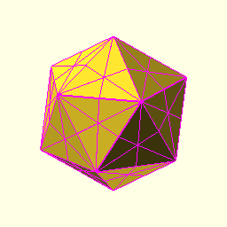

The other way to subdivide the kite is to cut along the 
short diagonal, that is, across the two midpoints.

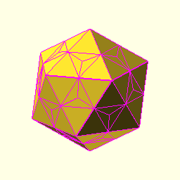

By varying the radii of the center and the midpoint relative to that of the vertex,
the user can design different stellated polyhedra. 
Example values below can be used to reproduce the presets,
which can serve as starting points of your stellated polyhedra design process.

| Split Type	 | Center Ratio	 | Mid Pt Ratio	 | Polyhedron				 | Image |
| :-:		 | :-:		 | :-:		 | :-:					 | :-: |
| 0 or 1	 | 1.255	 | 1.173	 | dodecahedron				 | 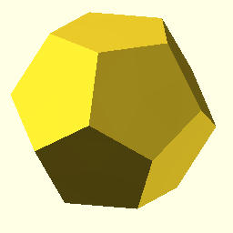 |
| 0 or 1	 | 0.793	 | 0.849	 | icosahedron				 | 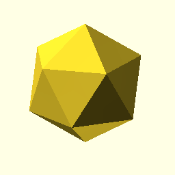 |
| 0		 | 0.911	 | 0.849	 | icosahedron dodecahedron compound	 | 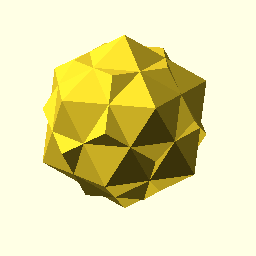 |
| 0 or 1	 | 0.957	 | 0.975	 | deltoidal hexecontahedron		 | 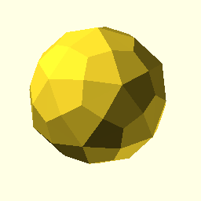 |
| 0		 | 0.911	 | 0.975	 | pentakis icosidodecahedron		 | 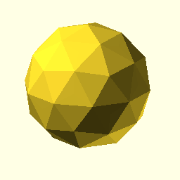 |
| 0		 | 1.093	 | 1.173	 | icosidodecahedron			 | 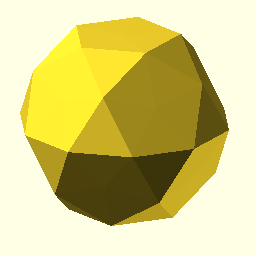 |
| 1		 | 0.911	 | 0.849	 | rhombic triacontahedron		 | 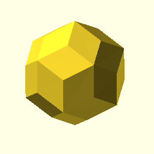 |
| 1		 | 1.066	 | 0.849	 | small triambic icosahedron		 | 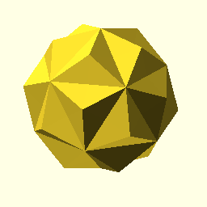 |
| 1		 | 1.170	 | 1.008	 | small icosacronic hexecontahedron	 | 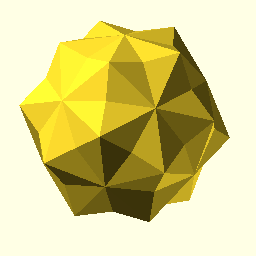 |
| 1		 | 1.000	 | 0.934	 | pentakis dodecahedron		 | 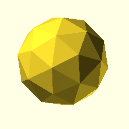
| 1		 | 0.911	 | 1.051	 | golden 120				 | 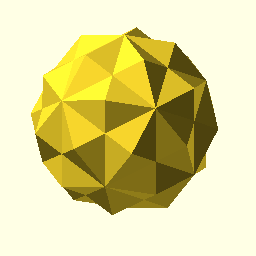 |
| 1		 | 1.066	 | 1.376	 | octahedron 5 compound		 | 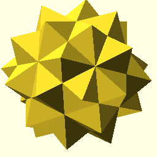 |

## Happy Stellating!
